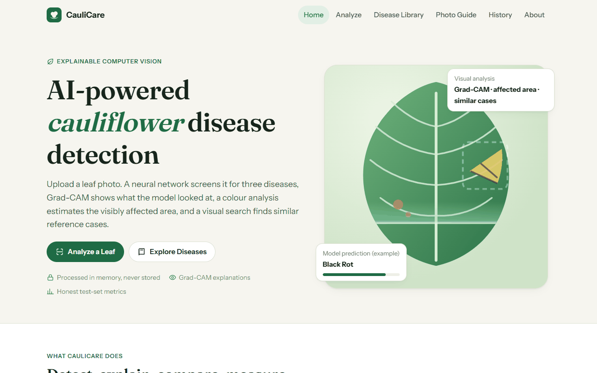
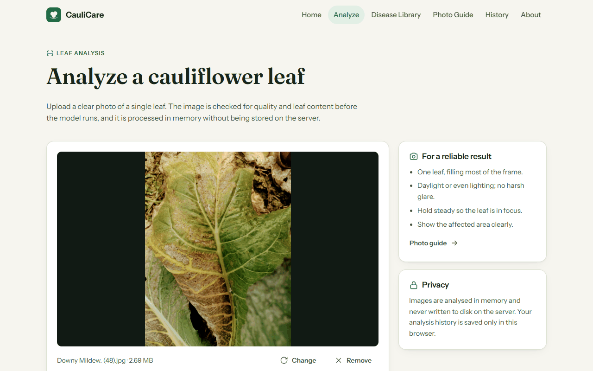
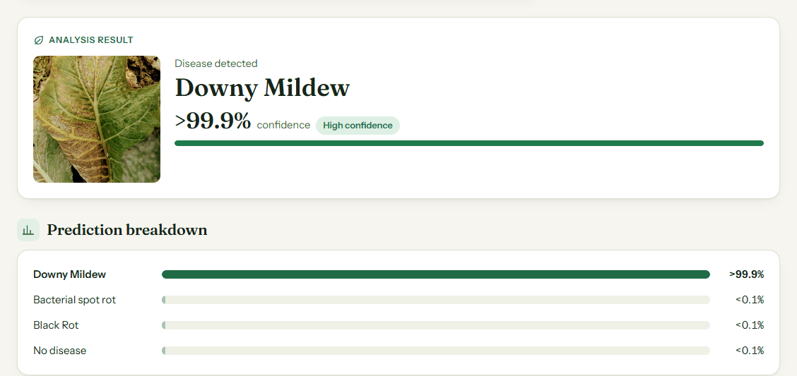
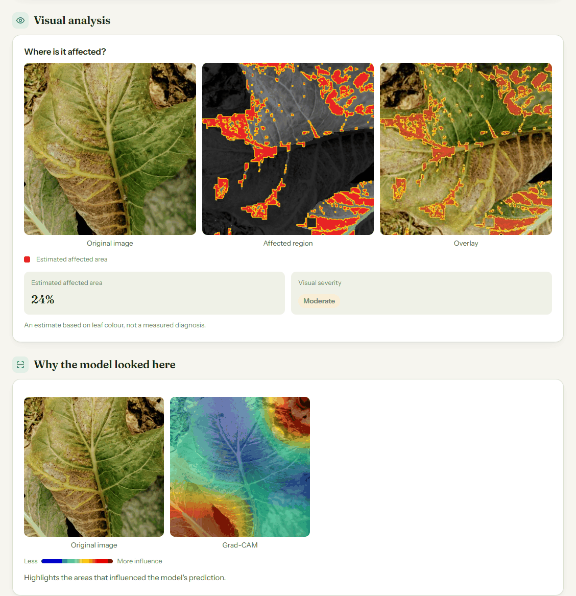
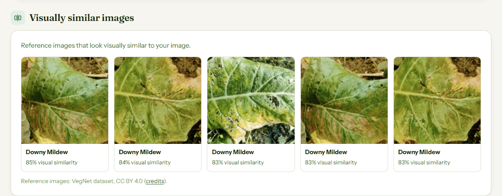
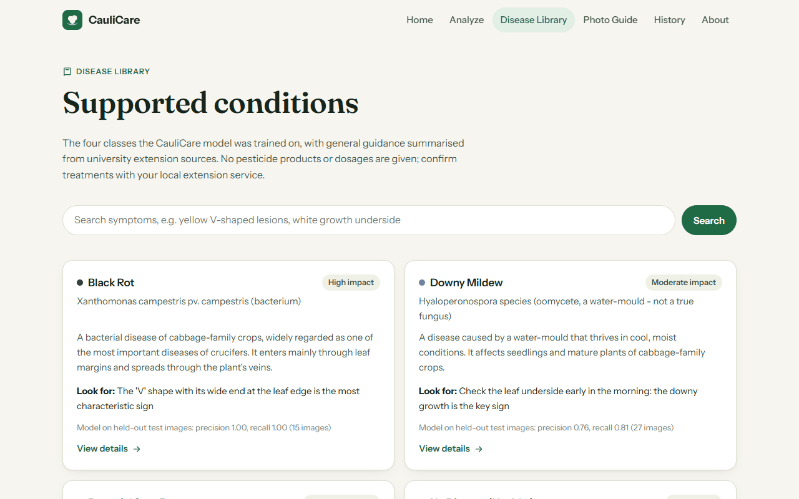
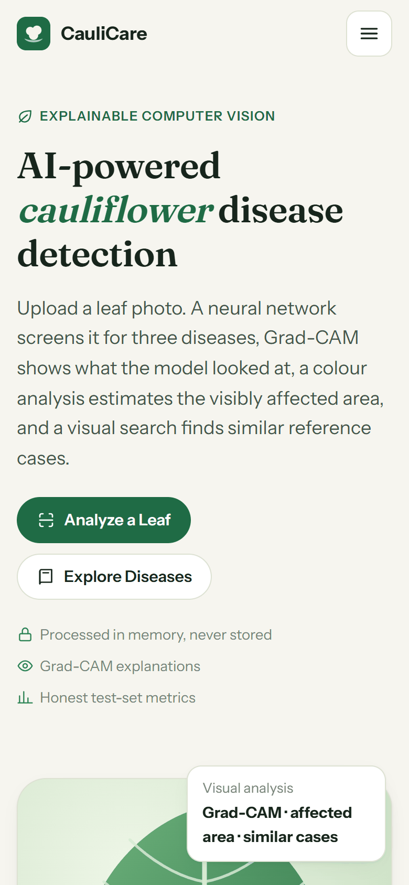
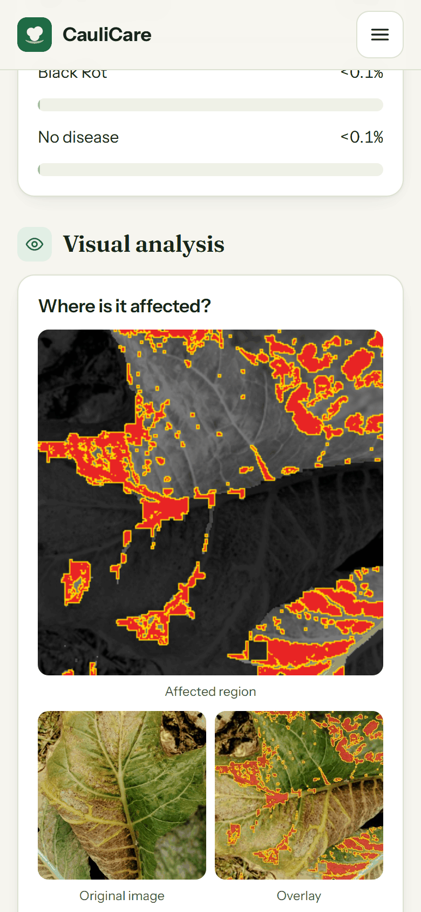
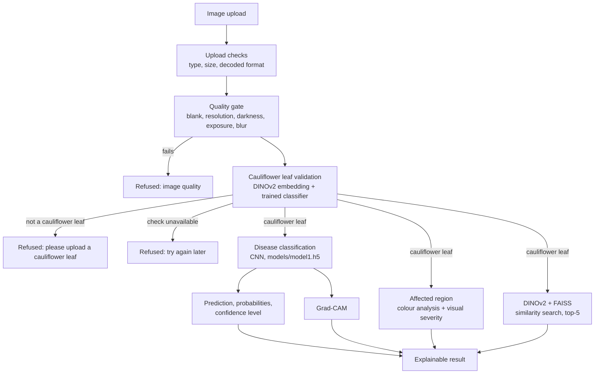
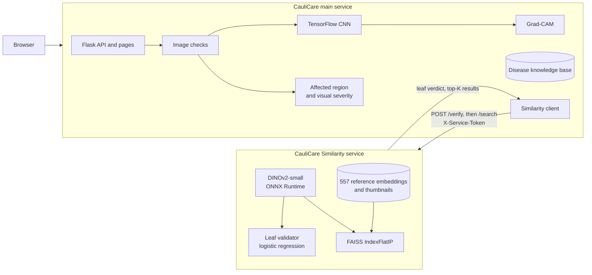

# CauliCare

**Explainable computer vision for cauliflower leaf disease detection.**

CauliCare screens a photo of a cauliflower leaf for three common diseases. Every upload is first checked by a trained cauliflower-leaf validator; images that are not cauliflower leaves are refused before any disease analysis. A convolutional neural network predicts the condition, Grad-CAM shows which regions influenced the prediction, a colour analysis highlights where the leaf looks visibly affected, and DINOv2 embeddings with FAISS retrieve visually similar reference images.

**Live demo:** [caulicare.onrender.com](https://caulicare.onrender.com/) (free hosting: the first visit after a period of inactivity can take a minute or more while the services wake up)

**Stack:** Python 3.11 · Flask · TensorFlow / Keras · ONNX Runtime · DINOv2 · FAISS · NumPy · Pillow · vanilla HTML / CSS / JavaScript · Docker · Render

CauliCare is also a complete **image classification and inference service**: validated uploads, per-class confidence scores, a machine-readable accept / uncertain / reject decision, held-out evaluation metrics, an OpenAPI-described JSON API, and measured inference optimisation. See [Project Requirements Coverage](#project-requirements-coverage) and [Inference Service](#inference-service).

## Overview

Leaf diseases such as Black Rot and Downy Mildew spread quickly in a cauliflower crop, and their early signs are easy to miss or confuse. CauliCare gives a fast, explained first opinion from a single photo:

- **Input:** one photo of a cauliflower leaf (JPG, PNG or WEBP, up to 8 MB).
- **Output:** the predicted condition with its confidence, the probability of every class, where the leaf looks affected, which regions the model relied on, visually similar reference images, and short disease information.

Photos that are not cauliflower leaves (people, animals, other plants, objects, documents, screenshots) or that are blank, too dark or blurry are refused with a clear reason instead of receiving a forced label.

## Features

- **Cauliflower Leaf Validation:** CauliCare verifies that the uploaded image is suitable for cauliflower leaf analysis before running disease classification, reducing misleading predictions on unrelated images (DINOv2 embedding + trained logistic-regression check; see [Cauliflower Leaf Validation](#cauliflower-leaf-validation)).
- **Disease classification:** Bacterial spot rot, Black Rot, Downy Mildew or No disease, with the probability of every class (TensorFlow CNN).
- **Confidence estimation:** each result is labelled High (≥ 95%), Moderate (80–95%) or Uncertain (< 80%).
- **Grad-CAM explainability:** a heatmap of the image regions that influenced the prediction.
- **Affected-region visualisation:** the original photo, the estimated affected region in red, and an overlay.
- **Visual severity estimate:** the estimated visible affected area as a percentage, with a display band (Low / Moderate / High / Very high).
- **DINOv2 visual similarity:** the most visually similar reference images, each with its class and visual-similarity score.
- **FAISS vector search:** exact inner-product search over 557 reference embeddings, in a separate lightweight service.
- **Disease information:** what each condition is, common symptoms, prevention and management, with sources, plus a searchable Disease Library and a Photo Guide.
- **Image checks:** file type and decoded format, size, blur, darkness, exposure and resolution.
- **History and reports:** past results are kept in the browser only; any result can be printed or saved as a self-contained HTML report.
- **Responsive UI** for phones, tablets and desktops.
- **Inference API:** a machine-readable `decision` (`accepted` / `uncertain` / `rejected`), ranked top-k classes, a compact response mode, a batch endpoint, request IDs, per-stage timings and an [OpenAPI specification](docs/openapi.yaml) (also at `/developers` and `/api/openapi.yaml`).
- **Fast inference:** the CNN and Grad-CAM also run on ONNX Runtime (about 3x faster than Keras), identical uploads are served from a cache, and the whole service can run **without TensorFlow** (about a fifth of the memory).
- **Security:** uploads processed in memory and never stored, per-client rate limiting, security headers (including a Content Security Policy), and error messages that never expose internals.

## Project Requirements Coverage

The project brief is an *AI image classification and inference service*: classify uploaded images, validate them, return classes with confidence scores, handle corrupted / unsupported / uncertain inputs, report evaluation metrics, and offer a simple interface or API. This is how each requirement is met.

| Requirement | How CauliCare meets it | Where |
|---|---|---|
| Classify plant diseases from uploaded images | Four-class cauliflower CNN: Bacterial spot rot, Black Rot, Downy Mildew, No disease | `models/model1.h5`, `services/predictor.py` |
| Validate uploaded images | Extension, MIME type, real format read from the bytes, size limit, decompression-bomb limit, corruption check, image-quality gate and a trained cauliflower-leaf validator that fails closed | `services/image_validation.py`, `routes/api.py` |
| Predicted class with confidence | `result.label` and `result.confidence`, ranked `top_k`, and the probability of every class | `POST /api/predict` |
| Corrupted and unsupported inputs | 22 hostile inputs answered with the right status and error code, no internals exposed ([results](#reliability-and-error-handling)) | `scripts/robustness_report.py` |
| Uncertain predictions | `decision: "uncertain"` below 0.80 (threshold chosen on the validation split) plus High / Moderate / Uncertain levels | `services/analysis.py` |
| Model evaluation metrics | Accuracy, macro precision / recall / F1, per-class table, confusion matrix, calibration; served by `GET /api/model`, the About page and `reports/` | [Model Evaluation](#model-evaluation) |
| Simple interface or API | Web UI plus a documented JSON API (single, compact and batch) | [`docs/openapi.yaml`](docs/openapi.yaml), `/developers` |
| Image preprocessing | NumPy resize pixel-identical to the training pipeline, EXIF handling, transparency flattened on white | `services/predictor.py` |
| Prediction reliability | Confidence levels, decision field, calibration study, fail-closed leaf validator, ONNX model verified against Keras at start-up | [Reliability](#reliability-and-error-handling) |
| Error handling | One JSON error shape with `code`, `decision` and `request_id`; rate limiting; clean 5xx messages | `routes/api.py`, `app.py` |
| Inference optimisation | ONNX Runtime backend, TensorFlow-free serving, result cache, compact and batch modes, a 4.7x faster affected-area estimate, per-stage timings, a reproducible benchmark | [Inference Optimisation](#inference-optimisation) |

## Screenshots

**Home**



**Upload**



**Analysis result:** the predicted condition, its confidence and the probability of every class.



**Visual analysis:** where the leaf looks affected (original, affected region, overlay), the visual severity estimate, and Grad-CAM.



**Similar images:** reference images retrieved with DINOv2 embeddings and FAISS.



**Disease Library**



**Mobile**

<p>
  
  &nbsp;
  
</p>

Screenshots were captured from the running application. The analysed photo is a held-out test image from the VegNet dataset (CC BY 4.0, see [Attribution](#attribution)).

## How It Works



In short: **Image Upload → Cauliflower Leaf Validation → Disease Classification → Grad-CAM → Affected Region → DINOv2 + FAISS Similarity Search → Explainable Result.**

1. **Upload checks:** the file must be JPG, PNG or WEBP and under 8 MB. Its real format is read from the bytes, so a renamed file is rejected.
2. **Quality gate:** brightness, exposure, sharpness and resolution are measured; the thresholds were set so that none of the 656 dataset photos is refused. Blank and tiny images are refused immediately. For a dark, overexposed or blurry image the leaf validator still runs, so a white document is told it is not a cauliflower leaf, while a badly lit leaf gets photo advice.
3. **Cauliflower leaf validation:** the image is sent to the similarity service, which embeds it with DINOv2 and scores it with a trained classifier. Below the threshold, the request ends here: no disease prediction, confidence, Grad-CAM, affected region or similar images are produced. If the check cannot be made (service asleep, down or not configured), the upload is refused rather than analysed unverified (**fail closed**).
4. **Preprocessing:** the image is converted to RGB and resized to 256 × 256 with a NumPy re-implementation of `tf.image.resize`, tested to be pixel-identical to the preprocessing used in training.
5. **Prediction:** the CNN returns a probability per class; the top class, its confidence level and the runner-up are reported.
6. **Grad-CAM:** gradients of the predicted class score with respect to the last convolution layer produce a heatmap.
7. **Affected region:** a colour analysis, independent of the CNN, finds the leaf and the yellow, tan and brown tissue inside it.
8. **Visual similarity:** the upload is sent to the similarity service's search **in parallel** with the CNN. The service reuses the embedding computed during validation, so DINOv2 runs once per upload. If the search fails, that section shows "temporarily unavailable" and everything else is unaffected.

The Analyze page shows these steps as they happen (Checking image → Cauliflower leaf detected → Analyzing disease): it calls `/api/verify` first and then `/api/predict`, which repeats every check on the server, so bypassing the page cannot skip validation.

## Architecture

CauliCare runs as **two services**. TensorFlow and DINOv2 together exceed a 512 MB instance (measured: the single-process version was killed for running out of memory on its second request), so everything that uses DINOv2 (the cauliflower-leaf validator and similarity search) runs in its own small service without TensorFlow. **The main service needs the similarity service for every analysis.**



| | Main service (`caulicare`) | Similarity service (`caulicare-similarity`) |
|---|---|---|
| Code | `app.py`, `routes/`, `services/` | `similarity_service/` |
| Responsibilities | Pages, upload checks, CNN, Grad-CAM, affected region, disease information, rate limiting | DINOv2 embedding, cauliflower-leaf validator, FAISS search, reference metadata and thumbnails |
| Dependencies | Flask, TensorFlow (or ONNX Runtime alone, see [Serving without TensorFlow](#serving-without-tensorflow)), NumPy, Pillow | Flask, ONNX Runtime, FAISS, NumPy, Pillow (no TensorFlow) |
| Health check | `GET /api/health` | `GET /health` |

How the services talk:

- The main service reads the similarity service's address from `SIMILARITY_SERVICE_URL`; no URL is hard-coded.
- Requests carry a shared secret in the `X-Service-Token` header (`SIMILARITY_SERVICE_TOKEN` in the main service, `SERVICE_TOKEN` in the similarity service).
- The similarity service validates every upload again (size, decoded format, pixel count). It returns only indexed reference images, with thumbnails inline as data URIs, and has no endpoint that takes a file path or an id.
- The main service validates every response field (id pattern, known class, similarity in [0, 1], thumbnail format) and drops anything else.
- Free-tier services sleep when idle. Opening the home or Analyze page sends a background `/health` ping so the similarity service starts waking while the visitor chooses a photo.

### API

The full contract is in [`docs/openapi.yaml`](docs/openapi.yaml) (served at `/api/openapi.yaml`) and summarised for humans at `/developers`.

| Method | Endpoint | Description |
|---|---|---|
| `POST` | `/api/predict` | Multipart field `image`. Query: `compact=1` (small response, no Grad-CAM / affected area / similarity), `explain=0` (skip Grad-CAM), `top_k=1..4`. **200** `status: ok` with `decision` (`accepted` or `uncertain`), `result`, the leaf check, prediction, probabilities, Grad-CAM, affected-area estimate, similar images and disease information. **422** `status: not_cauliflower_leaf` or `low_quality` (nothing analysed). **503** `code: leaf_check_unavailable` when the leaf check cannot be made |
| `POST` | `/api/predict/batch` | Multipart field `images` (up to 8 files). Each image is checked on its own, accepted ones share one batched forward pass. **200** with one entry per image; a bad file is reported in its entry (`success: false`, `code`, `http_status`) without failing the rest |
| `POST` | `/api/verify` | Same upload checks and cauliflower-leaf check only, without the disease model: **200** `status: cauliflower_leaf`, or the same 422 / 503 refusals |
| `GET` | `/api/model` | Model description, held-out evaluation (accuracy, macro P / R / F1, per-class, confusion matrix), calibration, reliability thresholds and which backend serves requests |
| `GET` | `/api/stats` | Request counts, decisions, status codes, cache hit rate and p50 / p95 latency per endpoint since the process started |
| `GET` | `/api/health` | Model status, inference backend and similarity-service configuration (used by the hosting platform) |
| `GET` | `/api/openapi.yaml` | The OpenAPI 3 specification |
| `GET` | `/api/diseases`, `/api/diseases/<id>` | Disease records |
| `GET` | `/api/search?q=...` | Symptom search over the knowledge base |
| `POST` | `/verify` *(similarity service)* | Multipart `image`; returns `is_cauliflower_leaf`, `score` and `threshold` |
| `POST` | `/search` *(similarity service)* | Multipart `image` and optional `k` (1–10); returns the top-K reference images |
| `GET` | `/health` *(similarity service)* | `{"status": "ok", "model_loaded": true, "index_loaded": true, "validator_loaded": true, ...}` |

Scores come both as a fraction (`confidence`, 0-1) and as a percentage (`confidence_percent`, `percent`, `all_predictions_percent`, one decimal).

Every JSON response carries `request_id` (also sent as the `X-Request-ID` header; send your own, 8-64 characters of `A-Za-z0-9._-`, to correlate calls with the logs).

```bash
curl -X POST "http://localhost:5000/api/predict?compact=1" -F "image=@leaf.jpg"
```

```json
{
  "success": true, "status": "ok",
  "decision": "accepted",
  "decision_reason": "The top class has 98.7% probability (high confidence).",
  "result": {"label": "Black Rot", "confidence": 0.9871, "confidence_percent": 98.7, "confidence_level": "high", "reliable": true,
             "top_k": [{"label": "Black Rot", "confidence": 0.9871, "percent": 98.7}, {"label": "Downy Mildew", "confidence": 0.0102, "percent": 1.0}, ...]},
  "inference": {"backend": "onnxruntime", "model": "model1.h5"},
  "timing_ms": {"read_upload": 1.0, "quality_gate": 11.7, "leaf_check": 0.0, "preprocess": 5.2, "inference": 9.7, "total": 28.1},
  "cached": false, "request_id": "4f2a9c1e7b3d5a60"
}
```

## Inference Service

### Decisions and confidence

Each classified image gets a `decision`, so a client does not have to interpret probabilities itself:

| `decision` | Meaning |
|---|---|
| `accepted` | The top class has probability of at least 0.80 (moderate 0.80-0.95, or high 0.95 and above) |
| `uncertain` | A prediction is returned but its probability is below 0.80. Fewer than half of such validation predictions were correct, so it should not be acted on automatically |
| `rejected` | Refused before classification: unsupported or corrupted file, too large, poor quality, or not a cauliflower leaf |
| `error` | A valid request the service could not complete (model unavailable, rate limit, internal error) |

**Second opinion.** In the full response the similarity search acts as an independent check (a different model, DINOv2, not trained on these diseases). If at least 80% of the most similar reference photos share a label that differs from the CNN's, the decision becomes `uncertain` and the page shows a warning (`second_opinion.agrees: false`). The label itself is never changed. Example: a photo of a harvested cauliflower head on a table was classified as Downy Mildew at over 99.9% while all five nearest reference photos were "No disease". The rule is a safeguard, not a validated classifier: its thresholds have not been tuned on the dataset, and it only flags; it cannot make the CNN right.

The 0.80 / 0.95 thresholds were chosen on the validation split. Scores are over-confident (mean top score 96.8% against 87.9% test accuracy), so even `accepted` results can be wrong; see [Limitations](#limitations).

### Reliability and error handling

`python scripts/robustness_report.py` sends 22 hostile or unusual inputs to `/api/predict` (real CNN, stubbed leaf check) and checks the status and error code of each. Result: **22 / 22 answered as specified, 0 responses exposed internals** (full table in `reports/robustness.json`).

| Input | Status | `code` |
|---|---|---|
| Valid JPEG / PNG / WEBP, or a browser that sends no content type | 200 | `accepted` / `uncertain` |
| No file, wrong form field name | 400 | `no_file` |
| Empty file | 400 | `empty_file` |
| Text renamed `.jpg`, truncated or half-downloaded JPEG | 422 | `corrupt_image` |
| PDF, GIF | 415 | `unsupported_extension` |
| GIF renamed `.png` | 415 | `unsupported_format` |
| PNG sent as `application/pdf` | 415 | `unsupported_mimetype` |
| Larger than 8 MB | 413 | `file_too_large` |
| 96-megapixel decompression bomb | 422 | `too_many_pixels` |
| Tiny, blank, almost black or very blurry image | 422 | `low_quality` |
| Not a cauliflower leaf | 422 | `not_cauliflower_leaf` |
| Leaf check cannot be made (service down) | 503 | `leaf_check_unavailable` (fails closed: nothing is analysed unverified) |
| Too many requests (a batch of N images counts as N) | 429 | `rate_limited` |

A model that is missing or fails to load gives a clean `503 model_unavailable`; unexpected exceptions give `500` with a generic message and the details only in the server log.

### Inference optimisation

Reproduce everything below with `python scripts/export_onnx.py` and `python scripts/benchmark_inference.py` (results in `reports/benchmark.json`). Measured on one Windows laptop (Python 3.11.9, TensorFlow 2.20.0, ONNX Runtime 1.20.1), 1 CPU thread as in the Docker / Render configuration, median of the quietest of 5 blocks of 40 runs. Compare the rows with each other, not with other machines; differences under about 20% are noise.

**What was done**

1. **ONNX Runtime backend.** `scripts/export_onnx.py` builds an ONNX copy of the CNN directly from the Keras weights (720 KB against 2236 KB) and checks it against Keras. At start-up the app compares the two again and ignores the ONNX file if they differ, so a retrained `.h5` can never be served through a stale `.onnx`.
2. **Grad-CAM from ONNX activations**, which removes the last reason to keep TensorFlow in the serving path ([below](#serving-without-tensorflow)).
3. **Profiling-driven fix of the affected-area estimate.** The per-stage timings showed it taking about 120 ms, far more than the CNN (10 ms). Pillow's 15 x 15 rank filter (61 ms) became an equivalent two-pass maximum / minimum (0.5 ms) and the PNG encoder setting was changed (38 ms to 4 ms): **122 ms to 26 ms with identical output** (the new code is tested against Pillow's filters and against the filter's definition).
4. **Compact mode** (`compact=1`) skips Grad-CAM, the affected-area estimate and the similarity search, and decodes the image once instead of twice.
5. **Result cache** keyed by the SHA-256 of the uploaded bytes (32 entries, `PREDICTION_CACHE_SIZE`). Only the hash and the finished result are kept, never the image; a temporary similarity-service failure is never cached.
6. **Batch endpoint** with one batched forward pass for all accepted images.
7. **Per-stage timings** (`timing_ms`) in every response, plus `/api/stats` percentiles, so the next bottleneck is visible.

**Results**

| Model forward pass, one 256 x 256 image | median | p95 |
|---|---|---|
| Keras (TensorFlow 2.20.0) | 34.9 ms | 41.5 ms |
| **ONNX Runtime, float32 (used)** | **10.3 ms** | 11.4 ms |
| ONNX Runtime, dynamic int8 (not used) | 11.2 ms | 12.7 ms |

Probabilities from the ONNX model differ from Keras by at most 9e-09 and the top class agrees on 32/32 images; the Grad-CAM heat-maps differ by at most 3e-07. Dynamic int8 quantisation (`export_onnx.py --quantize`) shrinks the file to 190 KB but is slightly *slower* here and changes probabilities by 3e-4, so it is not used.

| Throughput (images per second) | batch 1 | batch 4 | batch 8 | batch 16 |
|---|---|---|---|---|
| Keras | 30 | 55 | 62 | 67 |
| ONNX Runtime | 94 | 96 | 100 | 96 |

| One decoded photo to a prediction (median) | Keras | ONNX Runtime |
|---|---|---|
| With Grad-CAM heat-map and overlay | 99.7 ms | **32.6 ms** |
| Without Grad-CAM | 37.3 ms | **16.2 ms** |

| `POST /api/predict`, 1024 x 768 JPEG (median, network calls stubbed) | latency |
|---|---|
| Full analysis (Grad-CAM, affected area), Keras | 154 ms |
| Full analysis, ONNX Runtime | **83.7 ms** |
| `explain=0` (no Grad-CAM), ONNX Runtime | 63.4 ms |
| `compact=1`, ONNX Runtime | **31.8 ms** |
| Same image uploaded again (cache hit) | **1.7 ms** |
| 8 images, one `/api/predict/batch` request | 262 ms |
| 8 images, eight `compact=1` requests | 256 ms |

The last two rows show what batching buys: decoding and the quality gate dominate the CPU time per image, so a batch saves HTTP round trips and shares one forward pass, not processing time. The leaf check and similarity search are stubbed above; in production the leaf check adds one network round trip to the similarity service.

### Serving without TensorFlow

Set `INFERENCE_BACKEND=onnx` (and install `requirements-onnx.txt`, or build `Dockerfile.onnx`) and the main service never imports TensorFlow:

| Whole application, fresh process, 12 full analyses with Grad-CAM | TensorFlow | ONNX Runtime only |
|---|---|---|
| Start-up until the model is loaded | 8.4 s | **0.8 s** |
| Resident memory | 515 MB | **99 MB** |
| Median full request | 158 ms | **77.1 ms** |

`Dockerfile.onnx` was built and run: **432 MB image against 2.1 GB** for the TensorFlow image; started under a 512 MB limit next to a stub of the similarity service it used 62 MiB idle and 129 MiB after 26 requests (single, compact and batch; Docker's figure includes file cache), without being killed. In this mode:

- `models/model1.onnx` records the SHA-256 of the `.h5` it was exported from. If they differ (the model was retrained without re-exporting), the model is reported unavailable (`503`) instead of silently serving a stale network. Re-run `python scripts/export_onnx.py` after changing the model.
- TensorFlow is still needed for training, the tests and `scripts/export_onnx.py`.
- The hosted demo keeps `INFERENCE_BACKEND=tensorflow` (see [Deployment](#deployment)): loading ONNX Runtime *next to* TensorFlow costs another 60-100 MB, which a 512 MB instance cannot spare. The TensorFlow-free build was verified locally and in Docker, not on Render.

### Observability

- Every request gets an id (`X-Request-ID`); `/api/*` calls write one JSON log line with the id, route, status, latency, decision, predicted class, confidence level, backend and cache status. It never contains a file name, an address or image data.
- `GET /api/stats` reports request counts, decisions, status codes, cache hit rate and p50 / p95 latency per endpoint (in memory, per process).
- `GET /api/model` reports the evaluation figures and the serving backend; `GET /api/health` is the platform health check.

## Machine Learning

### Model

| | |
|---|---|
| Type | Custom CNN (Keras Sequential), trained from scratch |
| Architecture | 6 × [Conv2D 3×3 + MaxPool 2×2] (32 then 64 filters) → Flatten → Dense(64, ReLU) → Dense(4, softmax) |
| Parameters | 183,812 |
| Input | RGB, 256 × 256, raw 0–255 values; `Resizing` and `Rescaling(1/255)` layers are part of the model |
| Augmentation (training only) | Random horizontal/vertical flip and random rotation |
| Training | Adam (learning rate 0.001), sparse categorical cross-entropy, batch size 32, seed 42 |
| Files | `models/model1.h5` (2.3 MB), its ONNX export `models/model1.onnx` (0.7 MB, with `model1.gradcam.npz`) and `models/model_metadata.json` |

| Class | Description |
|---|---|
| Bacterial spot rot | Bacterial leaf spots and rots; the bacterium is not identified in the dataset |
| Black Rot | *Xanthomonas campestris* pv. *campestris*: yellow V-shaped lesions from the leaf margin, blackened veins |
| Downy Mildew | Water mould: angular yellow patches with downy growth on the leaf underside |
| No disease | Healthy leaf |

### Dataset

The **VegNet** cauliflower disease dataset (Rajbongshi et al., [doi:10.17632/t5sssfgn2v.3](https://doi.org/10.17632/t5sssfgn2v.3), CC BY 4.0), obtained through a [Kaggle re-upload](https://www.kaggle.com/datasets/noamaanabdulazeem/cauliflower-dataset): **656 original images** (Bacterial spot rot 173, Black Rot 100, Downy Mildew 177, No disease 206). Some photos show the cauliflower head rather than a leaf.

The dataset contains exact duplicates and near-identical burst shots. Images were grouped by perceptual hash and each group kept within one split (stratified by class, seed 42): **458 training / 99 validation / 99 test** images, with no duplicate pairs crossing splits (`data/splits.json`). The dataset itself is not in this repository; [`training/README.md`](training/README.md) explains how to download it.

### Model Evaluation

Measured once on the 99 held-out test images, which were not used for training or model selection:

| Metric | Value |
|---|---|
| Test accuracy | **87.9%** (87 / 99) |
| Macro F1 | **0.891** |
| Macro precision / recall | 0.893 / 0.891 |
| Training / validation accuracy | 98.3% / 89.9% |

| Class | Precision | Recall | F1 | Test images |
|---|---|---|---|---|
| Bacterial spot rot | 0.815 | 0.846 | 0.830 | 26 |
| Black Rot | 1.000 | 1.000 | 1.000 | 15 |
| Downy Mildew | 0.759 | 0.815 | 0.786 | 27 |
| No disease | 1.000 | 0.903 | 0.949 | 31 |

Confusion matrix (rows = actual, columns = predicted, in the order above):

```
[22  0  4  0]
[ 0 15  0  0]
[ 5  0 22  0]
[ 0  0  3 28]
```

9 of the 12 errors are confusions between Bacterial spot rot and Downy Mildew; the other 3 are healthy leaves predicted as Downy Mildew. A regularised variant (dropout, class weights, early stopping) reached 85.9% validation / 83.8% test accuracy and was not selected. Reports are in `reports/`; the pipeline is reproducible with the scripts in `training/`.

Confidence thresholds were chosen on the validation split: below 80%, fewer than half of validation predictions were correct. The model is over-confident (average top score 96.8% on the test set against 87.9% accuracy), so even High-confidence results can be wrong.

## Cauliflower Leaf Validation

The disease CNN always answers with one of its four classes, whatever the picture shows, so its prediction cannot be used to decide whether the picture is a cauliflower leaf. A separate check runs first.

**Model.** The upload is embedded with DINOv2-small (the same 384-d [CLS] embedding used for similarity search), and a logistic-regression classifier on that embedding gives a score from 0 to 1. Weights, bias and threshold are in `similarity_service/index/leaf_validator.json` (6 KB). Training and evaluation: `scripts/fetch_validator_data.py` (downloads the data) and `scripts/train_leaf_validator.py`; every number below is in `reports/leaf_validator.json`.

**Data** (4,639 images; none of them is in this repository):

| | Source | Licence | Train / val / test |
|---|---|---|---|
| Cauliflower leaves | VegNet (the disease dataset, existing splits) | CC BY 4.0 | 458 / 99 / 99 |
| Cauliflower leaves | Durjoy et al. 2025, *Cauliflower leaf diseases* (another farm and camera) | CC BY 4.0 | 291 / 97 / 338 |
| Not cauliflower | PlantDoc: leaves of 13 other crops, field photos | CC BY 4.0 | 562 / 187 / 187 |
| Not cauliflower | iBean leaves | MIT | 157 / 52 / 52 |
| Not cauliflower | Oxford-IIIT Pet: cats and dogs | CC BY-SA 4.0 | 360 / 120 / 120 |
| Not cauliflower | COCO 2017 val: people, vehicles, buildings, food, objects, scenes | Flickr licences | 540 / 180 / 180 |
| Not cauliflower, **never seen in training** | Oxford Flowers 102 | research use | – / – / 400 |
| Not cauliflower, **never seen in training** | Documents, slides, spreadsheets and app screenshots generated by the script | – | – / – / 160 |

Durjoy photos were grouped by perceptual hash so near-identical shots stay in one split. All 242 of its "Insect Hole" photos (a leaf condition absent from training) are in the test split only. **Threshold:** the highest score that keeps the validation false-rejection rate at or below 1% (0.717); the test split was not used for any choice.

**Results on the test split** (437 cauliflower leaves, 1,099 other images):

| Metric | Value |
|---|---|
| Accuracy | 99.87% |
| Precision / recall | 100% / 99.54% |
| F1 | 0.998 |
| **False acceptance** (other image accepted) | **0 of 1,099 (0.0%)**, including 0 of 560 image types never seen in training |
| **False rejection** (cauliflower leaf refused) | **2 of 437 (0.46%)**: the same VegNet Downy Mildew photo, stored twice in the dataset |

On the validation split: 2 of 539 other images accepted (0.37%) and 1 of 196 leaves rejected (0.51%). With zero errors in 1,099 images, the true false-acceptance rate is not proven to be zero; the 95% upper bound is about 0.3% for images like these.

Robustness, test leaves after a change (false rejection out of 437): rotated 90°, rotated 180°, mirrored, 40% darker, 40% brighter, half saturation or downscaled to 224 px: 0.5% each; cropped to the central 60%: 1.6%; **the leaf small on a large soil-coloured border: 8.9%.** No sampled other image was accepted after any of these changes.

Compared on the same test split:

| Check | False acceptance | False rejection |
|---|---|---|
| **Trained validator (used)** | **0.0%** | **0.46%** |
| Nearest-neighbour similarity to training leaves (no negatives needed) | 2.7% | 0.0% |
| Previous colour and texture heuristic | 75.6% | 0.9% |
| Validator and heuristic combined | 0.0% | 1.4% |

The heuristic is therefore no longer used to refuse images. **Why the second cauliflower dataset matters:** trained with VegNet as the only cauliflower source, the same recipe rejected 55% of the Durjoy test leaves. Real users' photos are a new source again, so their false-rejection rate may be higher than measured here.

## Explainability

The gradient of the predicted class score (taken before softmax, which otherwise saturates on confident predictions) with respect to the last convolution layer weights its feature maps; their weighted sum gives the heatmap. That layer is a 4 × 4 grid, so the map is coarse. It shows where the model's evidence came from, not proof that a highlighted area contains the disease. It is not used as a segmentation mask.

Grad-CAM is computed in TensorFlow (`GradientTape`) or, without TensorFlow, from the ONNX model's activations: for this network the gradient has a closed form (see `services/gradcam_onnx.py`), and the two heat-maps agree to 3e-7.

## Visual Affected-Area Analysis

The dataset has image-level labels only, with no lesion masks, so no segmentation model could be trained or validated. `services/severity.py` uses colour thresholds instead: it finds the leaf (green to blue-green tissue, enclosed holes filled) and counts yellow, tan and brown pixels inside it. Affected pixels are drawn in red on a dimmed copy of the photo. The percentage is shown with a display band (0–10% Low, 10–30% Moderate, 30–60% High, above 60% Very high), which is a convention, not a validated severity scale. On the test split, healthy leaves had a median estimate of 2.7%, Bacterial spot rot 10.9% and Downy Mildew 18.9%, while Black Rot is underestimated (5.4%). Details: `reports/visual_features.json`.

## Visual Similarity Search

Each upload is embedded with **DINOv2-small** (Meta AI, a general-purpose self-supervised vision transformer, Apache-2.0) run with **ONNX Runtime**. The 384-dimensional [CLS] embedding is L2-normalised and searched against the reference index with an exact **FAISS** `IndexFlatIP` (inner product = cosine similarity). Where FAISS cannot be loaded (some Windows machines), the service uses an identical NumPy search.

- **Reference index:** `similarity_service/index/` holds 557 training and validation images (the test split is excluded): `embeddings.npy`, `faiss.index`, `metadata.json` and 200 px thumbnails. These are committed, with attribution in [`ATTRIBUTION.md`](similarity_service/index/ATTRIBUTION.md).
- **Building it:** `python scripts/build_image_index.py --dataset "data/raw/Original Dataset"` after downloading the model and dataset.
- **Model file:** `similarity_service/models/dinov2-small.onnx` (88.5 MB) is not committed. `python similarity_service/download_model.py` downloads it from Hugging Face and checks its SHA-256; a mismatch exits with an error (and fails a build).
- **Sanity check:** on the 99 test images, the most similar reference had the same label 96 times. This overstates real-world performance, because many test photos have other photos of the same plant in the index.

The score shown is **visual similarity**, not a disease probability or a diagnosis confidence; DINOv2 was not trained on cauliflower diseases.

## Installation

Requires **Python 3.11**. TensorFlow is a large download (about 1.3 GB installed).

Windows (PowerShell):

```powershell
git clone https://github.com/<your-username>/caulicare.git
cd caulicare
python -m venv .venv
.venv\Scripts\Activate.ps1
pip install -r requirements-dev.txt
python similarity_service/download_model.py
```

If PowerShell blocks the activation script, run `Set-ExecutionPolicy -Scope CurrentUser RemoteSigned` once.

macOS / Linux:

```bash
git clone https://github.com/<your-username>/caulicare.git
cd caulicare
python3.11 -m venv .venv
source .venv/bin/activate
pip install -r requirements-dev.txt
python similarity_service/download_model.py
```

`requirements-dev.txt` installs both services and pytest. Each service also has its own minimal file (`requirements.txt`, `similarity_service/requirements.txt`).

## Local Development

An analysis needs **both services**: the main app sends every upload to the similarity service for the cauliflower-leaf check. `pip install -r requirements.txt` followed by `python app.py` starts the website, but without a reachable similarity service every upload is refused with "We couldn't check whether this photo shows a cauliflower leaf right now" (fail closed by design).

One-time setup (after the installation steps above): `pip install -r requirements-dev.txt` and `python similarity_service/download_model.py`.

Terminal 1, similarity service (port 8001):

```powershell
python -m similarity_service.app
```

Terminal 2, main app (port 5000), pointed at it:

```powershell
$env:SIMILARITY_SERVICE_URL = "http://localhost:8001"
python app.py
```

On macOS / Linux use `export SIMILARITY_SERVICE_URL=http://localhost:8001`. Then open http://localhost:5000. Check the connection with `GET http://localhost:5000/api/health` (`leaf_validation: true`) and `GET http://localhost:8001/health` (`validator_loaded: true`).

Settings can also go in a `.env` file: copy `.env.example` to `.env` (never commit it). Values already set in the environment take precedence over `.env`.

**Using the hosted similarity service.** `.env.example` sets `SIMILARITY_SERVICE_URL=https://caulicare-similarity.onrender.com`. That service requires its token, so also set `SIMILARITY_SERVICE_TOKEN` to the `SERVICE_TOKEN` value from the Render dashboard (never commit it). It must be running a version with the `/verify` endpoint, which is in this repository.

## Testing

```powershell
python -m pytest
```

**Result on Windows, Python 3.11: 306 passed, 8 skipped** (4 need the dataset, 1 needs FAISS, 3 need the DINOv2 model download).

What the suite covers:
- API, upload and quality checks, and security behaviour (rate limiting, proxy handling).
- **Cauliflower-leaf gate:** a rejected image never reaches the disease model or similarity search; an unreachable, misconfigured or malformed leaf check refuses the upload (fail closed); `/api/verify`; the service's `/verify` endpoint, token, embedding reuse and a missing or malformed validator file; with the real DINOv2 model, the committed validator accepts dataset leaves and rejects a document and an abstract image.
- Preprocessing (pixel-exact agreement with TensorFlow's resize), prediction output and Grad-CAM.
- **Inference service:** decisions and `top_k`; request IDs (a hostile `X-Request-ID` is replaced); per-stage timings; compact and batch modes (mixed good and bad files, per-image rate-limit cost, single uploads still limited to one image); the result cache (LRU, mode-separated, never caches refusals or a temporary similarity failure); `/api/model`, `/api/stats` and the structured log (no file names); every API route is documented in the OpenAPI file.
- **ONNX:** the exported model reproduces Keras; Grad-CAM from ONNX activations matches Keras and a hand-checked case; a stale, missing, broken or unsourced ONNX file is detected; **a subprocess in which `import tensorflow` fails serves full analyses with Grad-CAM**.
- The affected-area estimate, including proofs that the faster filter equals Pillow's and its own definition.
- **Similarity service:**
  - health, model and index loading, and search results;
  - invalid and malformed images, the token, and validation of the index metadata;
  - checks that no endpoint serves files.
- **Similarity client:**
  - timeouts, a service that is down, error statuses and invalid responses;
  - an end-to-end flow through real HTTP: main app → similarity service → result.

Most CNN tests use an untrained network with the real architecture, so no dataset is needed. With the dataset, the real-model tests also check that exactly 87 of 99 held-out test images are classified correctly:

```powershell
$env:CAULICARE_DATASET_DIR = "C:\path\to\Original Dataset"; python -m pytest
```

Two scripts exercise the whole service and double as regression checks: `python scripts/robustness_report.py` (22 hostile inputs, exits 1 on any difference) and `python scripts/benchmark_inference.py`.

## Docker

Each service has its own image:

```bash
docker build -t caulicare .
docker build -t caulicare-similarity similarity_service
```

- **Main image:** Python 3.11 slim, TensorFlow CPU and gunicorn, about 2.1 GB.
- **Main image without TensorFlow:** `docker build -f Dockerfile.onnx -t caulicare-onnx .` serves the same API from ONNX Runtime (`INFERENCE_BACKEND=onnx`), about 0.4 GB; see [Serving without TensorFlow](#serving-without-tensorflow).
- **Similarity image:** ONNX Runtime and FAISS with no TensorFlow, about 0.7 GB. The DINOv2 model is downloaded and checksum-verified during the build.
- Both images run as a non-root user and define a `HEALTHCHECK`.

Run both on one network:

```bash
docker network create caulicare
docker run -d --name caulicare-similarity --network caulicare -e SERVICE_TOKEN=change-me caulicare-similarity
docker run -d --name caulicare --network caulicare -p 8080:8080 \
  -e SIMILARITY_SERVICE_URL=http://caulicare-similarity:8001 -e SIMILARITY_SERVICE_TOKEN=change-me caulicare
```

Then open http://localhost:8080.

## Deployment

[`render.yaml`](render.yaml) is a Render Blueprint that defines both services on the free plan:

| Service | Build | Start | Health check |
|---|---|---|---|
| `caulicare` | `pip install -r requirements.txt` | gunicorn, 1 worker, 4 threads | `/api/health` |
| `caulicare-similarity` | `pip install -r similarity_service/requirements.txt && python similarity_service/download_model.py` | gunicorn, 1 worker, 2 threads | `/health` |

Steps:

1. In Render, choose **New → Blueprint** and select the repository.
2. Render creates both services. `SERVICE_TOKEN` is generated for the similarity service and copied into the main service as `SIMILARITY_SERVICE_TOKEN`.
3. When the Blueprint asks for `SIMILARITY_SERVICE_URL`, enter the similarity service's public URL, for example `https://caulicare-similarity.onrender.com`. You can also set it later under the main service's **Environment** tab.

Memory settings for the 512 MB instances (`MALLOC_ARENA_MAX`, single-threaded math libraries, one analysis at a time, `INFERENCE_BACKEND=tensorflow`) are part of the Blueprint. Free services sleep after 15 minutes without traffic, so cold starts are slow; see [Limitations](#limitations).

## Project Structure

```
caulicare/
├── app.py                     # Main Flask app factory and error handlers
├── config.py                  # Settings from environment variables
├── routes/
│   ├── api.py                 # JSON API (/api/predict runs the CNN and calls the similarity service)
│   └── pages.py               # Home, Analyze, Disease Library, Photo Guide, History, Report, About
├── services/
│   ├── predictor.py           # Model loading (Keras / ONNX / both), preprocessing, inference, confidence, Grad-CAM
│   ├── image_validation.py    # Upload checks and the image-quality gate
│   ├── severity.py            # Affected-region estimate and its visualisation
│   ├── similarity_client.py   # Validated, fail-safe client for the similarity service
│   ├── analysis.py            # Combines checks, prediction and disease information; decision field
│   ├── cache.py               # SHA-256-keyed LRU result cache
│   ├── telemetry.py           # Request IDs, stage timings, structured logs, statistics
│   ├── onnx_export.py         # Keras -> ONNX exporter (no tf2onnx)
│   ├── gradcam_onnx.py        # Grad-CAM from ONNX activations (NumPy)
│   ├── knowledge_base.py      # Disease records and symptom search
│   └── security.py            # Rate limiting and security headers
├── similarity_service/        # Separate service: DINOv2 + FAISS (no TensorFlow)
│   ├── app.py                 # /health, /verify (leaf check) and /search
│   ├── validator.py           # Cauliflower-leaf validator (logistic regression on the embedding)
│   ├── engine.py              # Encoder, vector index, search
│   ├── config.py
│   ├── download_model.py      # SHA-256-verified DINOv2 download (run at build time)
│   ├── index/                 # 557 reference embeddings, FAISS index, metadata, thumbnails,
│   │                          # leaf_validator.json (validator weights and threshold)
│   ├── models/                # preprocessor_config.json (+ downloaded dinov2-small.onnx)
│   ├── requirements.txt
│   └── Dockerfile
├── templates/                 # Jinja pages
├── static/                    # CSS, JavaScript, favicon
├── models/                    # model1.h5, model1.onnx (+ .gradcam.npz), model_metadata.json
├── data/                      # diseases.json (knowledge base), splits.json (train/val/test)
├── training/                  # Reproducible dataset report, split, training, evaluation
├── scripts/                   # build_image_index.py, evaluate_visual_features.py,
│                              # fetch_validator_data.py, train_leaf_validator.py,
│                              # export_onnx.py, benchmark_inference.py, robustness_report.py
├── reports/                   # Evaluation and training reports, learning curves
├── notebooks/Model.ipynb      # Original training notebook
├── tests/                     # pytest suite (both services)
├── docs/
│   ├── openapi.yaml           # API specification (also served at /api/openapi.yaml)
│   └── screenshots/           # README screenshots
├── Dockerfile                 # Main service image (TensorFlow)
├── Dockerfile.onnx            # Main service image without TensorFlow
├── render.yaml                # Render Blueprint (two services)
├── requirements.txt           # Main service
├── requirements-onnx.txt      # Main service without TensorFlow
├── requirements-dev.txt       # Both services + pytest
├── .env.example
└── ATTRIBUTION.md
```

Not in the repository: the dataset (download: [`training/README.md`](training/README.md)) and the DINOv2 model file (download: `python similarity_service/download_model.py`).

## Attribution

- **Dataset:** VegNet: An organized dataset of cauliflower disease, by Aditya Rajbongshi, Umme Sara, Rashiduzzaman Shakil, Bonna Akter and Mohammad Shorif Uddin.
  - Published on Mendeley Data: [doi:10.17632/t5sssfgn2v.3](https://doi.org/10.17632/t5sssfgn2v.3).
  - Licensed under [CC BY 4.0](https://creativecommons.org/licenses/by/4.0/).
  - The reference thumbnails are resized copies of the training and validation images.
- **Model:** [DINOv2-small](https://huggingface.co/facebook/dinov2-small) by Meta AI, Apache-2.0.

Full details are in [`ATTRIBUTION.md`](ATTRIBUTION.md).

## Limitations

- **Accuracy:** 87.9% on 99 held-out test images. The test set is small (15 Black Rot images), so each figure carries several points of uncertainty.
- **Same plants across splits:** near-identical files are kept together, but different photos of the same plant can be in both training and test sets. Test accuracy and similarity agreement are therefore likely optimistic for photos of new plants.
- **Known confusion:** Bacterial spot rot and Downy Mildew are often confused, sometimes with high confidence.
- **Over-confidence:** scores are not calibrated; High confidence does not guarantee a correct result.
- **Single dataset:** 656 photos from one region. Performance on other farms, cameras and lighting is unknown.
- **Closed set:** the model knows four classes; other diseases, pests or nutrient problems will be mapped to one of them.
- **Leaf validation:** measured on public datasets, not on real users' uploads. Leaves of close relatives (cabbage, broccoli, kale) were not in any test set and may be accepted. Cauliflower heads may be accepted, because some VegNet training photos show the head. A leaf photographed small on a large soil background is the most likely real leaf to be refused (8.9% in the robustness test), and photos from new cameras or farms may be refused more often than the measured 0.46%.
- **Leaf validation depends on the similarity service:** if it is asleep or down, uploads are refused with "try again" rather than analysed unverified. On free hosting the first upload after an idle period can wait up to 75 s for it to wake.
- **Grad-CAM** is coarse (4 × 4 grid) and is an interpretability aid, not a disease mask.
- **Visual severity estimate:** colour thresholds, not a trained segmentation model. Soil, shadows, dead leaves and glare can be miscounted, pale symptoms can be missed, and Black Rot is underestimated.
- **Visual similarity** measures general visual closeness from a model that was not trained on these diseases.
- **Free hosting:** each service has 512 MB of memory and a small CPU share, so an analysis takes several seconds. Services sleep when idle and a cold start takes a minute or more. If the similarity service is still waking, that section shows "temporarily unavailable" while the rest of the result is complete.
- **History** is stored per browser and is lost when browser data is cleared.
- **Statistics and the result cache** live in memory, per process: they reset on restart and are not shared between workers.
- **Benchmarks** come from one laptop with the network calls stubbed. Use them to compare rows, not as absolute numbers; real-image accuracy of the ONNX model was not re-measured because the dataset is not in this repository (on random inputs its probabilities match Keras to 1e-8, and the test suite checks the real-model accuracy when the dataset is present).
- **ONNX next to TensorFlow costs memory:** the hosted 512 MB demo therefore keeps TensorFlow only; the TensorFlow-free build is not deployed there.
- **Batching** reduces round trips and shares one forward pass, but each image still gets its own quality gate and leaf check, so it does not reduce CPU time per image.

## Future Improvements

- Annotate lesion masks for a subset of images to train and validate a real segmentation model.
- Re-split the dataset by plant rather than by file for a fairer test set.
- Test the leaf validator on real users' photos and on cabbage, broccoli and kale leaves, and add them to its training data.
- Collect field photos from more locations and devices, and evaluate on a larger independent test set.
- Fine-tune a pretrained backbone (for example EfficientNet) and compare on the same held-out split.
- Deploy the TensorFlow-free image to the hosted demo and measure it under Render's CPU and memory limits.
- Improve calibration: temperature scaling fitted on the validation split did not reduce test calibration error (ECE 0.102 → 0.102), so raw scores are served; a larger validation set or other methods may help.

## Disclaimer

CauliCare's results come from machine-learning models and can be wrong. They are intended for screening and learning, not as a definitive agricultural diagnosis. Confirm important decisions, such as removing plants or applying treatments, with a local agricultural extension officer or plant-health laboratory.
